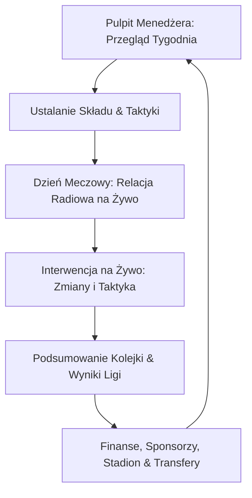

# Plan Projektu Gry: Polska Liga Manager 2026

## 1. Wizja i Inspiracja

**Polska Liga Manager 2026** to przeglądarkowy menedżer piłkarski łączący przystępność, szybkość i niepowtarzalny polski klimat kultowej serii **Liga Polska Manager 2005** (MarkSoft) ze współczesnymi standardami technologicznymi (**Next.js 15, TypeScript, Tailwind CSS, Supabase**) oraz aktualnymi realiami polskiej piłki na **sezon 2026**.

---

## 2. Piramida Ligowa (Realia 2026)

Gra odwzorowuje strukturę polskich rozgrywek ligowych:
1. **PKO BP Ekstraklasa (Tier 1):** 18 klubów (m.in. Lech Poznań, Legia Warszawa, Raków Częstochowa, Jagiellonia Białystok, Pogoń Szczecin, Górnik Zabrze, Widzew Łódź itd.)
2. **Betclic 1. Liga (Tier 2):** 18 klubów (m.in. Wisła Kraków, Ruch Chorzów, Arka Gdynia, Polonia Warszawa, ŁKS Łódź itd.)
3. **Betclic 2. Liga (Tier 3):** 18 klubów (m.in. Wieczysta Kraków, Polonia Bytom, Zagłębie Sosnowiec, Hutnik Kraków itd.)
4. **Betclic 3. Liga - Gr. IV (Tier 4):** 16 klubów (m.in. Siarka Tarnobrzeg, KSZO Ostrowiec, Star Starachowice itd.)
5. **Klasa Okręgowa / Regionalna (Tier 5):** 16 klubów regionalnych (m.in. Mazur Karczew, Victoria Sulejówek, Start Otwock, Naprzód Brwinów itd.)

---

## 3. Kluczowe Filary Rozgrywki (Core Gameplay Loop)

### A. Silnik Meczowy & Relacja Radiowa (Studio S-13)
- **Symulacja krokowa (minuty 1–90+):** Przeliczanie szans na bramki, obrony, spalone, faule, żółte/czerwone kartki i kontuzje na bazie siły formacji (Obrona, Pomoc, Atak, Bramkarz), formy, morale i kondycji.
- **Komentarz radiowy:** Ponad 100 barwnych opisów w języku polskim w stylu klasycznych sprawozdawców radiowych.
- **Zarządzanie prędkością:** 1x, 2x, 5x, 10x oraz przycisk Pauzy w dowolnej chwili.
- **Interwencja menedżera na żywo:** Możliwość przeprowadzenia do 5 zmian zawodników oraz natychmiastowej zmiany nastawienia (np. z defensywnego na „wszystko na jedną kartę”).
- **Pauza w przerwie:** Automatyczne zatrzymanie meczu w 45. minucie na korekty taktyczne.

### B. Tryby Rozgrywki
1. **Tryb Kariery (Single Player):** Gracz prowadzi 1 klub z dowolnej ligi, reszta rozgrywek jest symulowana przez zaawansowany silnik AI.
2. **Tryb 2 Graczy (Hotseat):** Dwóch graczy prowadzi wybrane przez siebie kluby, rywalizując na rynku transferowym i w tabeli ligowej.

### C. Zarządzanie Klubem & Finanse
- **Polityka biletowa:** Suwak ceny biletów zależny od rangi meczu i pojemności stadionu.
- **Centrum Inwestycji Stadionu:**
  - Nowe trybuny (+2 000 miejsc siedzących)
  - Jupitery (oświetlenie)
  - Podgrzewana murawa
  - Gabinet medyczny (szybszy powrót po kontuzjach)
  - Szkółka juniorów (generowanie talentów)
  - Baza treningowa (wzrost umiejętności)
- **Rynek transferowy:** Baza wolnych agentów z możliwością negocjacji kontraktów oraz rozwiązywania umów ze zbędnymi graczami.

### D. Prasa Sportowa & Kronika
- Cotygodniowe wydanie „Przeglądu Futbolowego 2026” z podsumowaniem kolejek, liderów i doniesień z rynku transferowego.

---

## 4. Stack Technologiczny & Baza Danych

- **Frontend & App:** Next.js 15+ (App Router), TypeScript, Tailwind CSS, Lucide Icons, Canvas Confetti.
- **Zarządzanie Stanem:** Zustand z dwustronną synchronizacją:
  - `localStorage` (działanie offline bez logowania)
  - `Supabase PostgreSQL` (zapis stanu kariery w chmurze w tabeli `game_saves`).
- **Skrypt bazy danych:** `supabase/schema.sql` z politykami Row Level Security (RLS).
